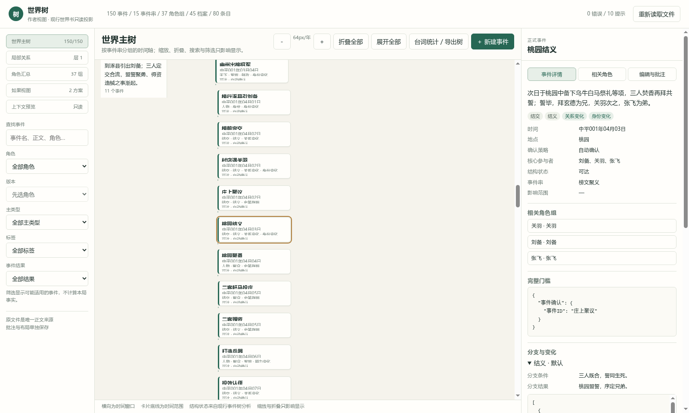

# Yggdrasill 世界树

> 让长篇世界卡保留完整故事，只在此刻呈现相关内容。

**Yggdrasill** 是一套面向 **SillyTavern（酒馆）长篇/多分支世界卡** 的设计规范与本地工具链。

在传统的长篇或同人世界卡中，把完整剧情塞进世界书往往会导致上下文过载、剧透未来事件，或让角色在不同阶段出现设定冲突；而一味删减内容，又会丢失故事的骨架与分支感。

Yggdrasill 用**时间和门槛**把剧情组织成事件树，用**时期档案**记录角色随故事推进的变化，并把本局已经发生的事写进可检查、可重放的记录里——**作者得以保留完整的原作路线与 if 分支，而模型每次只接收当前场景真正需要知道的角色、事件和条目。**



---

## 核心概念与工作流

如果你第一次接触 Yggdrasill，可以先把它的运行方式理解为三个核心机制：

1. **事件树与门槛**：事件不再孤立触发，而是通过时间先后、前置条件（门槛）和分支关系彼此连接，原作主线与 if 路线共用同一套结构。
2. **角色时期档案**：同一个角色组可以拥有多个不同时期的档案（例如“初遇期”“黑化后”），开局初始化时根据本局历史自动匹配当前适用的版本。
3. **本局状态与楼层记录**：游玩过程中的剧情推进通过协议命令写入本局记录，支持逐层检查、重放与回档，避免长对话后状态失控。

整体协作流程如下：

```text
  世界书源文件（事件树 / 时期档案 / 设定条目）
         │
         ├──▶ [校验与维护] CLI 静态检查 · 引用溯源 · 影响面分析 · YAML 排版
         │
         ├──▶ [可视与编辑] 本地作者视图 (view) —— 浏览主树 · 对比 if 线 · 编辑单事件
         │
         └──▶ [酒馆运行]   开局初始化（按历史筛选当前内容）──▶ 游玩中写本局与楼层记录（可重放/回档）
```

---

## 它能做什么

- **保留完整叙事与分支**：用同一套结构管理主线与 if 线，事件前后因果清晰可控。
- **角色状态随剧情演进**：按本局历史选择对应的角色时期档案，减少跨阶段串戏与剧透。
- **可追溯的游玩记录**：协议命令写入本局，支持楼层记录的检查、重放与回档。
- **长篇世界书工程化维护**：内置检查器、引用溯源、影响面分析、初始化预览与 YAML 排版工具。
- **可视化的作者视图**：无需提前生成额外索引，直接在本地网页查看世界主树、局部关系、角色汇总、如果视图并编辑单个事件。
- **AI 辅助写卡流程**：仓库内置 6 个作者 `skills`，可引导编程代理按分级规范进行世界书编辑与验证。

---

## 快速开始

### 环境要求

- [Node.js](https://nodejs.org/) **20** 或更高版本

### 1. 安装依赖

```bash
git clone https://github.com/groundgrounder/Yggdrasill.git
cd Yggdrasill
npm ci
```

### 2. 用内置示例体验检查与可视化视图

仓库附带了完整的《雾港》世界书示例，可以直接运行以下命令体验：

```bash
# 检查雾港示例世界书的引用与规范
node cli/ygg.mjs check examples/雾港/世界书

# 启动本地作者视图（自动分配空闲端口；审阅状态写在仓库外）
node cli/ygg.mjs view --worldbook examples/雾港/世界书 --storage ../雾港-审阅 --port 0
```

执行第二条命令后，终端会输出一个本机访问地址（仅监听 `127.0.0.1`），在浏览器中打开即可浏览事件树、查看引用关系、对比 if 路线或编辑单个事件。终端按 `Ctrl + C` 即可停止服务。

审阅状态（批注与布局）必须写在世界书与实现仓库之外；示例写到仓库上一级，真实项目可省略 `--storage`，默认是 `<世界书父目录>/作者资料/审阅器`。

> 作者视图会直接读取你的世界书文件。关于视图的保存范围、自动备份与并发规则，请见[作者视图文档](view/README.md)。

### 3. 载入配套预设

[`presets/yggdrasill.json`](presets/yggdrasill.json) 是配合酒馆使用的 SillyTavern 补全预设：主提示词限定叙述者身份与正文边界，另有一条可编辑的输出长度提示。在酒馆的「预设 → 导入」中载入该文件即可。世界书内容仍由角色卡与脚本注入，预设只影响正文如何生成。

<!-- 建议：如果你有其他常用子命令（如初始化预览、YAML 排版、构建角色卡等），可以在这里补一个简短的 CLI 常用命令速查表 -->

---

## 阅读指南与文档导航

不同角色可以从最适合你的入口开始：

| 你想做什么 | 推荐阅读 |
| --- | --- |
| 第一次接触，想从头了解写卡方法 | [作者指南](docs/作者指南.md) |
| 查阅字段定义、数据结构与完整规则 | [规范正本](docs/README.md) |
| 使用本地网页浏览事件树或编辑单个事件 | [作者视图文档](view/README.md) |
| 了解酒馆中的开局、记账、楼层记录与角色卡构建 | [酒馆适配](docs/06-酒馆适配.md) |
| 配合编程代理辅助写卡与检查 | [作者 Skill 说明](skills/README.md) |

> **边界说明**：本地作者视图专注浏览与单事件内容编辑；事件的新增、删除、改名以及跨文件引用迁移，仍需在源文件中完成。

---

## Skills

仓库在 [`skills/`](skills/README.md) 中内置了 6 个面向写卡作者的 Agent Skill，用于在配合 AI 编程代理编写或维护长篇世界书时，把编辑、校验与交付过程标准化。

### 共同约束

- **只依据规范与作者资料工作**：读取 `docs/`、`skills/shared/`、当前世界书与它的 `作者资料/`；工具只通过 `node cli/ygg.mjs` 调用，不翻看 `core/`、`checker/`、`view/` 等实现代码，也不为让检查通过而改检查器或测试。
- **不替作者编造设定**：规范未定义、字段冲突或缺少世界观与角色细节时先询问作者；名单、迁移值与越界断言都交作者确认，不擅自补剧情。
- **先定边界再动手**：改前在临时副本上记录基线与输入哈希，用 `trace` 与 `if` 列出影响面；大范围重构、改名或跨文件调整先确认范围；不自动安装依赖或启动作者视图，改后按约定的检查口径复核。

### Skill 分工

| Skill | 适用场景 | 核心工作 |
| --- | --- | --- |
| `ygg-build`（建立） | 从原作逐篇建立整套世界书 | 定名单、预建角色组、逐章建事件树与事件串，按篇审阅 |
| `ygg-setting`（设定） | 增删改 `设定/` 中的第二层声明 | 列反向清单，迁移因此失效的第三层字段与文本提及 |
| `ygg-event`（事件） | 新建或修改事件、分支、门槛、变化、事件串、开局 | 锁定对象与引用，写结构；已有事件的文本交 `ygg-text` |
| `ygg-character`（角色） | 新建或修改角色组、版本、档案元数据、别名、初始能力与所在 | 维护版本与档案的适用关系，写档案骨架 |
| `ygg-profile`（建角色） | 从作者资料新写档案正文 | 分栏稳定事实与状态事实，写 `基本信息.txt` 与 `角色印象.txt` |
| `ygg-text`（文本） | 修订已有第四、五层正文、条件文本与分支结果 | 锁定文本字段与五槽适用范围，改字后复核适用范围 |

快速开始：

- **从零建卡**：`ygg-build` 逐篇建立；单点新建用 `ygg-event` 或 `ygg-character`，档案正文交 `ygg-profile`。
- **专题扩写**：分支与门槛用 `ygg-event`；角色阶段用 `ygg-character` 定结构与 `ygg-profile` 写正文；改声明用 `ygg-setting`；不确定影响面时先按 `skills/shared/编辑分级.md` 定级，跑 `trace` 与 `if`。
- **交付收口**：按 `skills/shared/编辑分级.md` 的口径跑 `check`、`trace`、`if`、`preview` 与 `format`，把“改动前已有”和“本次新增”的问题分开报告。

> 更多触发说明与具体执行步骤，见 [作者 Skill 说明](skills/README.md)。

---

## 仓库结构

```text
Yggdrasill/
├── LICENSE          # Apache License 2.0
├── NOTICE           # 版权署名
├── core/            # 核心解析、事件图谱与状态规则实现
├── checker/         # 静态检查与检查规则
├── cli/             # 命令行入口（ygg.mjs）
├── view/            # 本地作者视图服务端与前端页面
├── skills/          # 面向编程代理的写卡与检查工作流 Skill
├── presets/         # 酒馆补全预设
├── templates/       # 世界书与相关配置模板
├── defaults/设定/   # 默认基础设定
├── examples/雾港/   # 完整示例世界书
├── docs/            # 作者指南、规范正本与酒馆适配文档
└── test/            # 自动化测试（基于 node:test）
```

---

## 开发与测试

```bash
npm test
```

测试使用 Node.js 内置的 `node:test`。作者视图的保存范围与备份规则见 `view/README.md`。

---

## 许可协议

本项目以 [Apache License 2.0](LICENSE) 发布，版权归 groundgrounder 所有，署名见 [NOTICE](NOTICE)。规范、文档、模板、示例与代码同属本仓库，采用同一许可。
